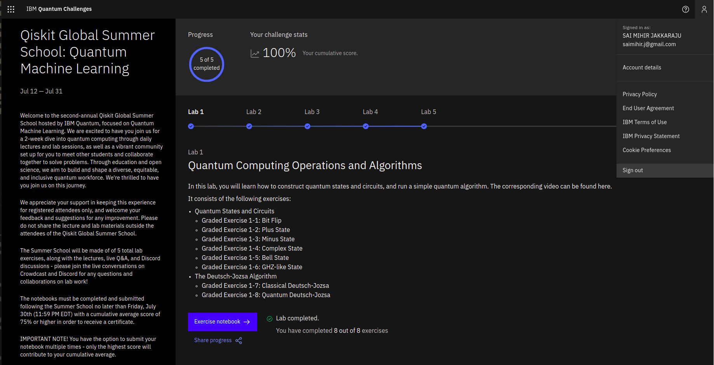

# Qiskit Global Summer School 2021: Quantum Machine Learning

My completed labs from IBM Quantum's 2021 Qiskit Global Summer School on quantum computing and quantum machine learning (July 12 to 23, 2021). I completed all five labs with a cumulative score of 100% and received the [Certificate of Quantum Excellence](Certificate.pdf).

| Lab | Topic |
|---|---|
| [Lab 1](Labs/lab-1.ipynb) | Introduction to Qiskit: single-qubit rotations, Bloch-sphere measurements, Bell and GHZ states, and the Deutsch-Jozsa algorithm |
| [Lab 2](Labs/lab-2.ipynb) | Variational algorithms: parameterized circuits and classical optimizers |
| [Lab 3](Labs/lab-3.ipynb) | Quantum kernels and support vector machines |
| [Lab 4](Labs/lab-4.ipynb) | Training parameterized quantum circuits |
| [Lab 5](Labs/lab-5.ipynb) | How noise affects parameterized circuits: quantum process tomography with shot noise |

Each notebook contains my solutions and their saved outputs.

## Running the labs

The notebooks were written for the Qiskit release current in mid-2021, and several of the APIs they use have since changed, so they run as written only with that version.

## License

MIT. See [LICENSE](LICENSE).
